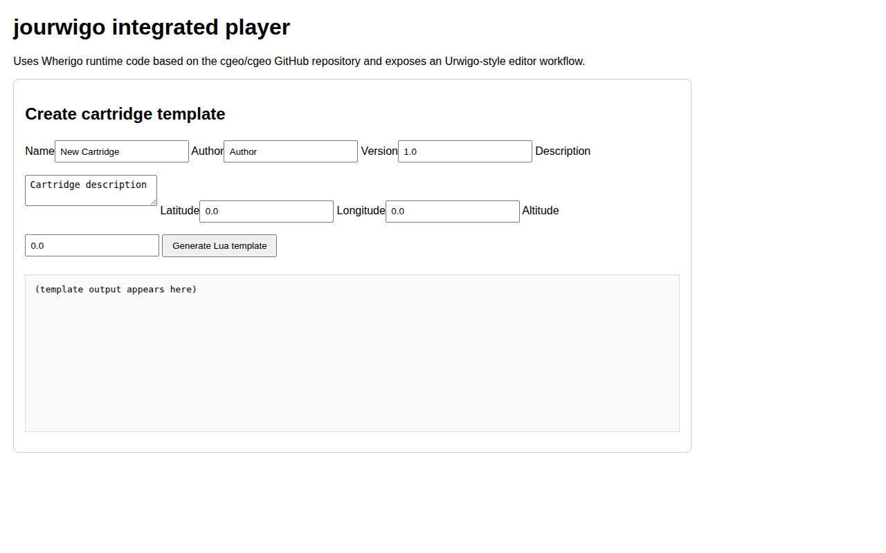
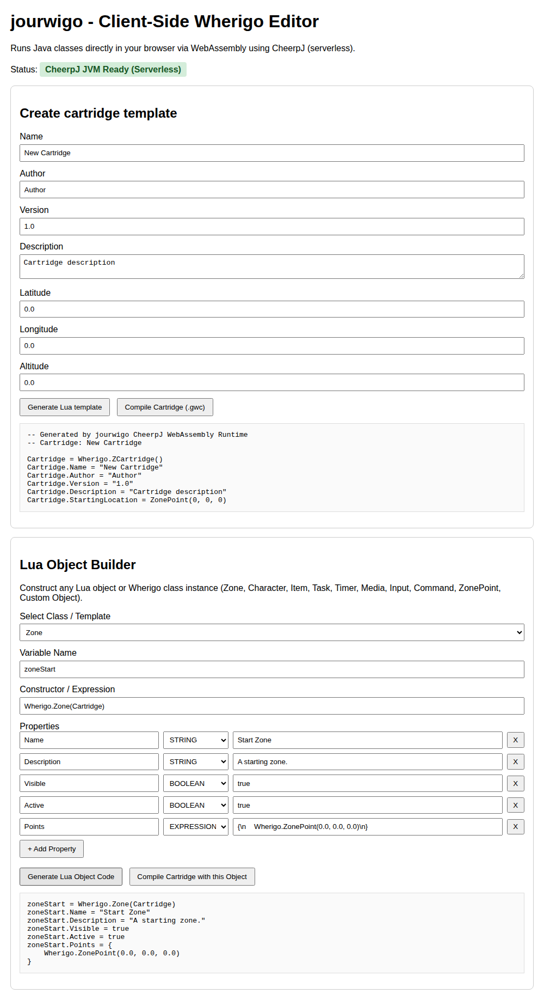

# jourwigo
Your Java Urwigo!

## Build

- Maven: `mvn test` / `mvn package`
- Gradle: `./gradlew test` / `./gradlew build`

## Desktop GUI

- `java -jar jourwigo-<version>-jar-with-dependencies.jar --gui` launches a JavaFX desktop UI.
- **Run Cartridge** tab opens and runs `.gwc` cartridges with editable simulated GPS coordinates.
- **Create Cartridge** tab creates a Lua cartridge template (`.lua`) that can be compiled into `.gwc`.
- **Web Integration** tab starts the built-in web editor shell and loads it directly in JavaFX via WebView.

## Integrated web editor shell

- `java -jar jourwigo-<version>-jar-with-dependencies.jar --web [port]` starts a lightweight web interface.
- The integrated approach uses cgeo/cgeo Wherigo runtime classes for robust cartridge execution and Urwigo-style template generation for editor workflows.

## Client-Side WebAssembly Editor (CheerpJ)

- Client-side WebAssembly editor running Java runtime classes directly in the browser via CheerpJ (serverless).
- Generates Lua cartridge templates and compiles `.gwc` cartridges directly on the client side without backend dependencies.
- Includes a Lua Object Builder to visually construct Wherigo objects (Zone, Character, Item, Task, Timer, Media, Input, Command, ZonePoint, Custom Object).
- Automatically deployed to GitHub Pages.

## MediaPicker Lua Extensions

The engine provides Lua binding functions under `Wherigo` for taking photos and picking media files:

- `Wherigo.SnapPhoto()`: Opens the camera or file chooser to capture a photo. Returns a `Wherigo.ZMedia` object (or `nil` if cancelled).
- `Wherigo.PickFile(mimeType)`: Opens a file picker with an optional MIME type filter (e.g. `"image/*"`, `"audio/*"`, `"text/plain"`). Returns a `Wherigo.ZMedia` object (or `nil` if cancelled).

### Working with returned `Media` (`ZMedia`) objects

The returned `Media` object is fully compatible with Wherigo cartridges (`Wherigo.made(Wherigo.ZMedia, media)` returns `true`) and supports the following properties and methods:

- **Properties:**
  - `media.Filename` / `media.FilePath` / `media.Path`: Path to the media file on disk.
  - `media.Type` / `media.MediaType`: Extension or media type (e.g., `"jpg"`, `"png"`, `"mp3"`, `"txt"`).
  - `media.Text` / `media.Content`: For text media, returns the file's text contents.
- **Methods:**
  - `media:Play()` / `media:Stop()`: Play or stop audio/video media playback.
  - `media:Show()`: Display the media or its text content in a dialog box.
  - `media:Read()` / `media:GetText()`: Read and return text contents from text media files.

## Inspiration and code sources

- Inspired by Urwigo.
- Code sources include cgeo, openwig, and kahlua.
